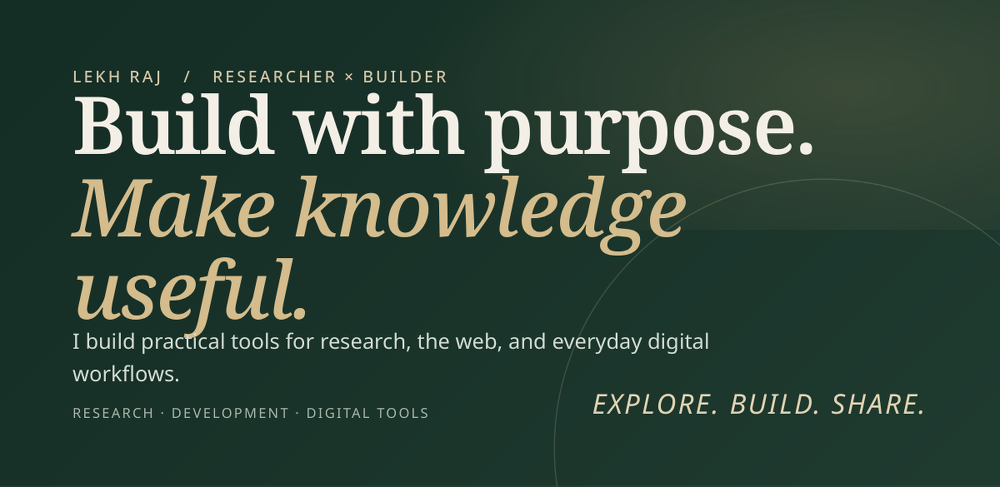
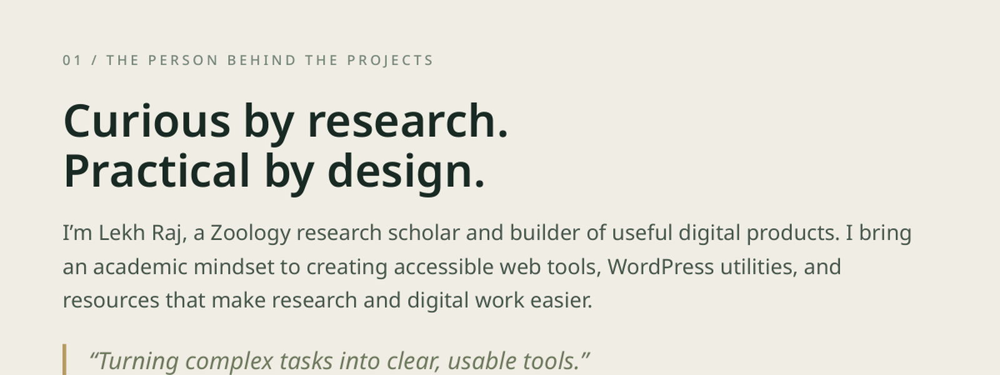
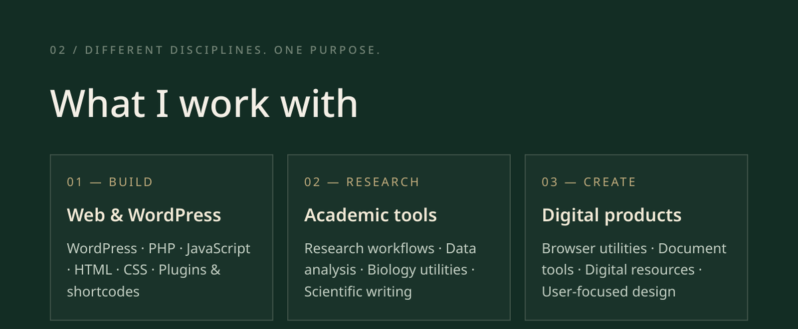
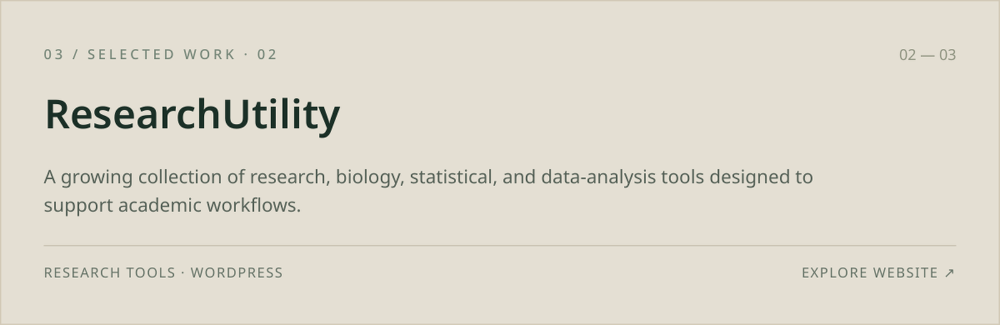
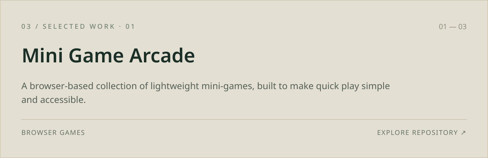
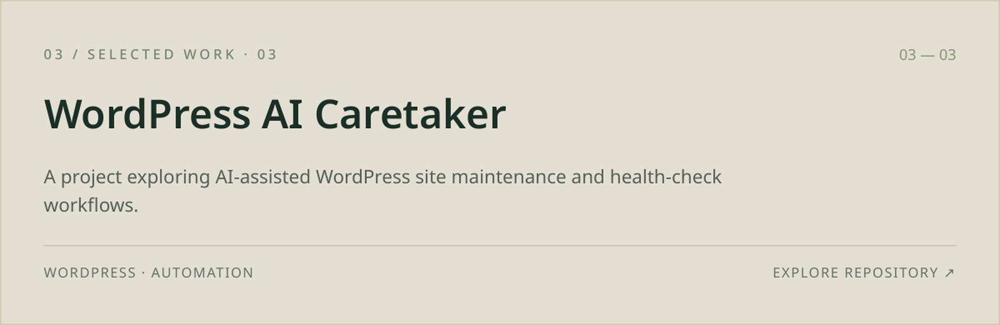
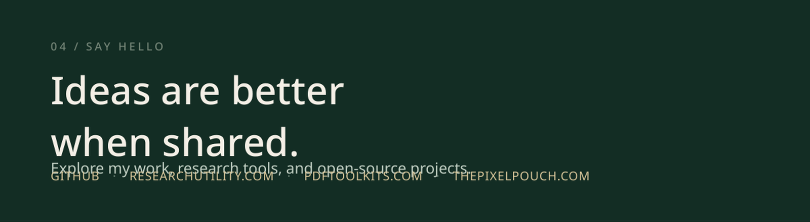

  <!-- Hero Banner -->
  

    

  <!-- Quick Badges -->
  
  
  
  

    

  <!-- About Section -->
  

    

  <!-- Tech Stack & Toolkit -->
  

    

  <!-- Featured Projects -->
  

    

  

    

  

    

  <!-- Dynamic GitHub Activity -->
  

    
    
  

   

  <!-- Contact Banner -->
  

    

  <!-- Footer Navigation -->
  

    <b>Explore Ecosystem:</b> 
    <a href="https://researchutility.com">ResearchUtility</a> •
    <a href="https://thepixelpouch.com">The Pixel Pouch</a> •
    <a href="https://pdftoolkits.com">PDFToolkits</a> •
    <a href="https://github.com/mr-lekhraj">GitHub Repositories</a>
  

