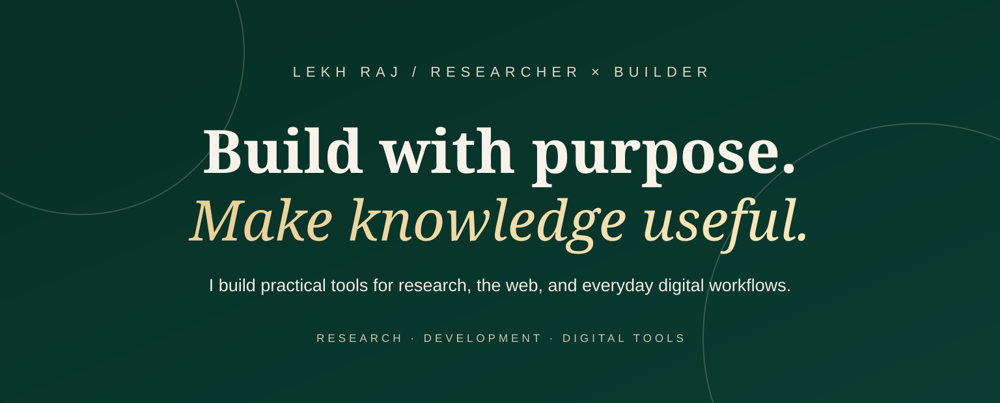
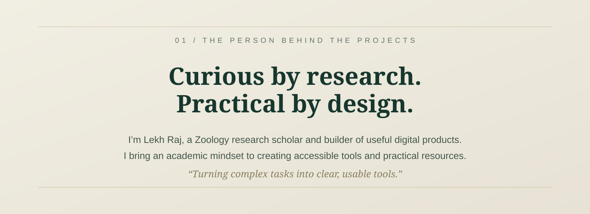
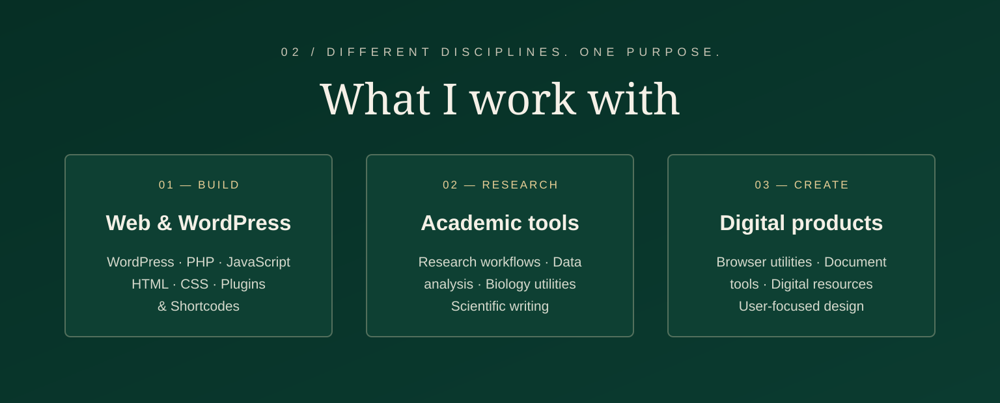
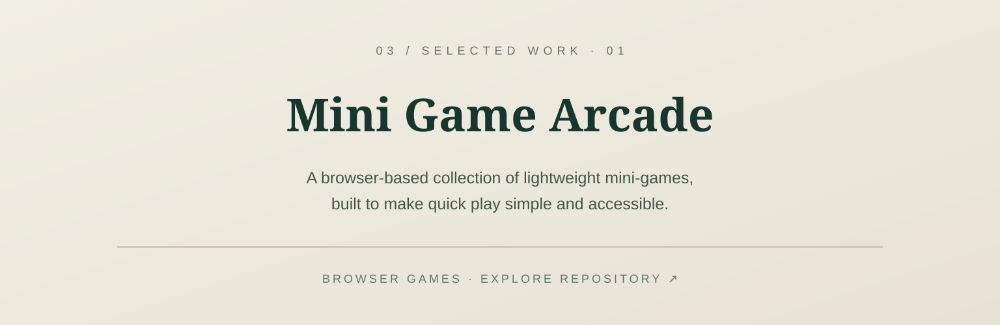
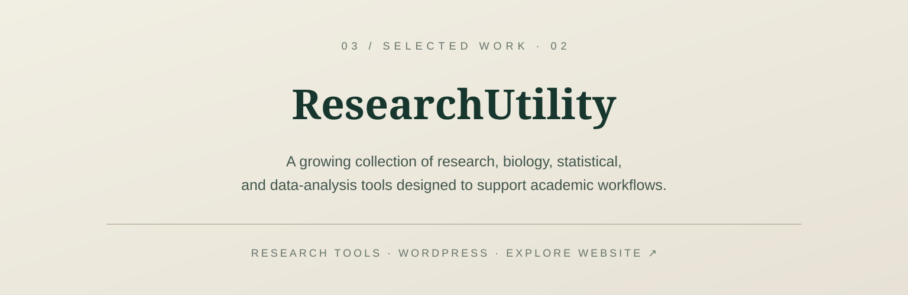
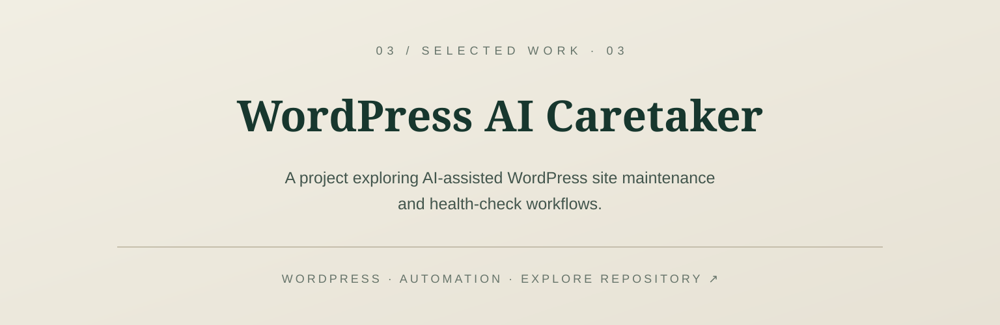

  

  

  

<!-- FEATURED WORK 01: MINI GAME ARCADE -->

  

<!-- FEATURED WORK 02: RESEARCHUTILITY -->

  

<!-- FEATURED WORK 03: WORDPRESS AI CARETAKER -->

  

<!-- FEATURED WORK 04: THE PIXEL POUCH -->

  

<!-- CONTACT BANNER -->

  

  <a href="https://github.com/mr-lekhraj">GitHub</a> ·
  <a href="https://researchutility.com">ResearchUtility</a> ·
  <a href="https://thepixelpouch.com">The Pixel Pouch</a> ·
  <a href="https://pdftoolkits.com">PDFToolkits</a>

