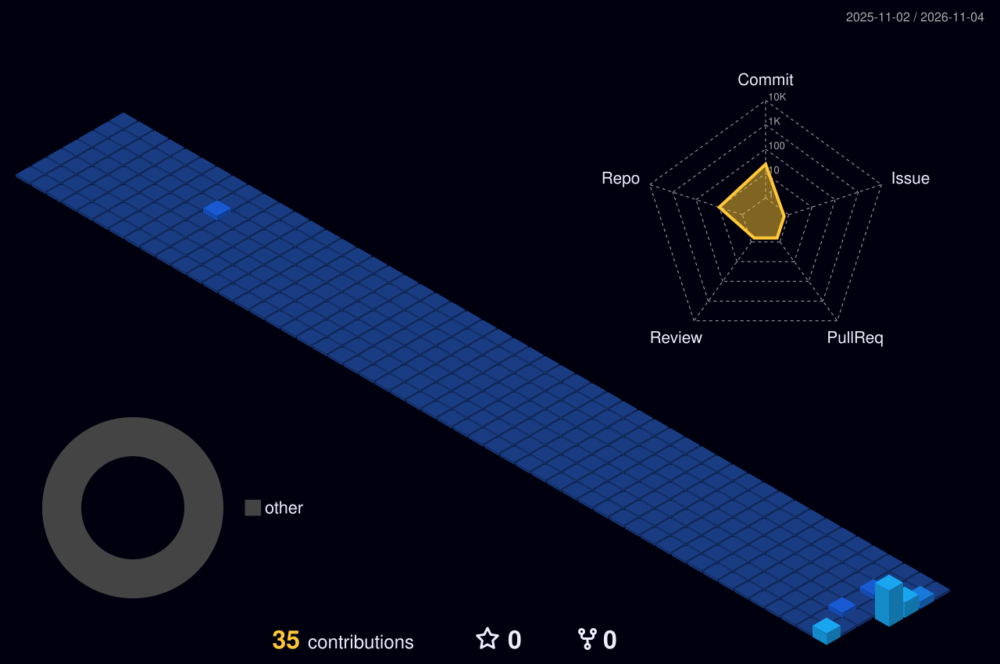

 

## 🧬 Researcher Profile

I am **Lekh Raj**, a Ph.D. Research Scholar in Zoology, interested in understanding biological systems and turning practical problems into useful digital tools.

- 🎓 **Academic domain:** Zoology, insect physiology, genotoxicity and neuroendocrine biology.
- 🔬 **Research methods:** Comet assay, histological staining, experimental biology and statistical analysis.
- 🧪 **Research interests:** Insect–plant interactions, DNA damage assessment and neurosecretory systems.
- 💡 **Builder mindset:** Developing accessible tools for researchers, students, creators and everyday users.
- 🌱 **Currently exploring:** AI-assisted research workflows, web technologies and open-source development.

## 🍃 My Research & Build Path

<table>
<tr>
<td width="33%" valign="top" align="center">

### 🔬 Research & Science

Zoology · Experimental biology · Genotoxicity · Neuroendocrinology · Research methodology · Scientific data analysis

</td>
<td width="33%" valign="top" align="center">

### 💻 Web & Development

WordPress · PHP · JavaScript · HTML · CSS · Custom plugins · Responsive interfaces · GitHub

</td>
<td width="33%" valign="top" align="center">

### 🚀 Digital Products

Research utilities · PDF tools · Browser games · eBooks · Templates · Creator resources

</td>
</tr>
</table>

## 🏆 Featured Missions

*Selected projects where research, creativity and technology come together.*

<table>
<tr>
<td width="50%" valign="top" bgcolor="#102f35">

<h3>🧪 <a href="https://researchutility.com">ResearchUtility</a></h3>

**Your research, made easier.**

A growing platform of academic, statistical, biology and research methodology tools for students and researchers.

**Explore:** Research calculators · Biology tools · Data analysis

<a href="https://researchutility.com"><b>EXPLORE PROJECT →</b></a>

</td>
<td width="50%" valign="top" bgcolor="#182b43">

<h3>🕹️ <a href="https://mini-game-arcade.vercel.app">Mini Game Arcade</a></h3>

**Small games. Big fun.**

A browser-based collection of lightweight mini-games built for quick, accessible entertainment.

**Explore:** Browser games · Front-end development · UI interaction

<a href="https://mini-game-arcade.vercel.app"><b>PLAY ONLINE →</b></a>

</td>
</tr>
<tr>
<td width="50%" valign="top" bgcolor="#342b20">

<h3>🛍️ <a href="https://thepixelpouch.com">The Pixel Pouch</a></h3>

**Digital resources for creative minds.**

A digital product marketplace for eBooks, templates, learning resources and creator bundles.

**Explore:** eBooks · Templates · Learning bundles

<a href="https://thepixelpouch.com"><b>VISIT MARKETPLACE →</b></a>

</td>
<td width="50%" valign="top" bgcolor="#30252b">

<h3>📄 <a href="https://pdftoolkits.com">PDFToolkits</a></h3>

**Everyday PDF tasks, simplified.**

A collection of online document utilities for common PDF workflows.

**Explore:** Merge · Split · Compress · Rotate PDF

<a href="https://pdftoolkits.com"><b>OPEN PDFTOOLKITS →</b></a>

</td>
</tr>
<tr>
<td width="50%" valign="top" bgcolor="#202d3d">

<h3>🧩 <a href="https://github.com/mr-lekhraj/wordpress-ai-caretaker">WordPress AI Caretaker</a></h3>

**Smarter WordPress workflows.**

An AI-assisted project exploring practical ways to support WordPress website maintenance and operations.

**Explore:** WordPress · AI-assisted workflows · Site operations

<a href="https://github.com/mr-lekhraj/wordpress-ai-caretaker"><b>VIEW REPOSITORY →</b></a>

</td>
<td width="50%" valign="top" bgcolor="#25352d">

<h3>📚 <a href="https://github.com/mr-lekhraj/academic-research-success">Academic Research Success</a></h3>

**Support for the research journey.**

A project focused on academic research productivity, learning resources and researcher support.

**Explore:** Research productivity · Learning · Academic resources

<a href="https://github.com/mr-lekhraj/academic-research-success"><b>VIEW REPOSITORY →</b></a>

</td>
</tr>
</table>

<a href="https://github.com/mr-lekhraj?tab=repositories"><b>→ Explore all my repositories</b></a>

## ⚙️ Technology Arsenal

  

## 📊 GitHub Mission Dashboard

 

 

## 🌃 My Contribution City

*Every contribution is another small step in the journey of learning and building.*

## 🐍 Contribution Journey

<picture>
<source media="(prefers-color-scheme: dark)" srcset="./profile-3d-contrib/github-contribution-grid-snake-dark.svg"/>
<source media="(prefers-color-scheme: light)" srcset="./profile-3d-contrib/github-contribution-grid-snake.svg"/>

</picture>

  

**Stay curious. Keep researching. Keep building.** 🌱

