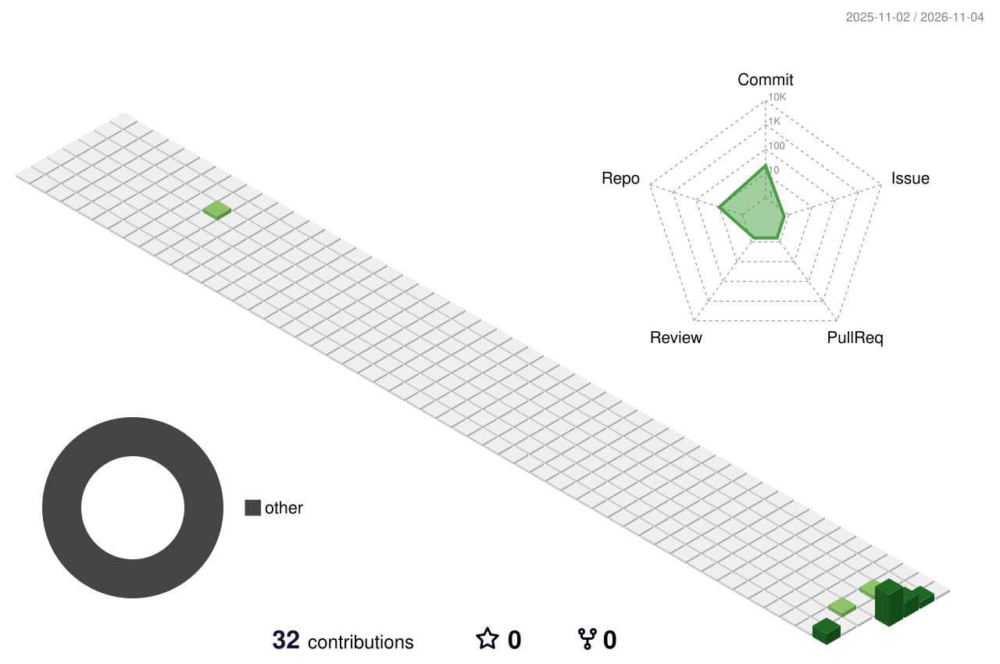

  
  <h1>Hi there, I'm Lekh Raj 👋</h1>
  <h3>Ph.D. Research Scholar in Zoology | Research Technology Builder | Digital Creator</h3>
  

    
    
    
  

  
<em>Connecting scientific thinking with practical technology — building useful tools for researchers, creators, and curious minds.</em>

---

## 🧑‍🔬 About Me

I'm **Lekh Raj**, a Zoology research scholar with a strong interest in research methodology, scientific data analysis, web development, and building accessible digital tools.

- 🎓 **Academic focus:** Zoology, insect physiology, genotoxicity, and neuroendocrine research.
- 🔬 **Research experience:** Experimental biology, comet assay, histological staining, and statistical analysis.
- 🧰 **Builder focus:** Research calculators, WordPress tools, browser utilities, and digital products.
- 🌱 **Currently exploring:** AI-assisted research workflows, useful open-source tools, and better digital experiences.
- 🎯 **My goal:** Make research and technology more accessible, practical, and easier to use.

## 🧭 What I Build

<table>
<tr>
<td width="33%" valign="top">
<h3 align="center">🔬 Research & Science</h3>

Research workflows · Biology tools · Data analysis · Scientific writing · Academic utilities

</td>
<td width="33%" valign="top">
<h3 align="center">💻 Web & Development</h3>

WordPress · PHP · JavaScript · HTML · CSS · Custom plugins · Responsive interfaces

</td>
<td width="33%" valign="top">
<h3 align="center">🚀 Digital Products</h3>

Browser tools · Document utilities · Templates · eBooks · Creator resources

</td>
</tr>
</table>

## 🚀 Featured Projects

<table>
<tr>
<td width="50%" valign="top">
<h3>🧪 <a href="https://researchutility.com">ResearchUtility</a></h3>

A platform of academic research, statistical, and biology tools designed to support students and researchers.

<b>Focus:</b> Research methodology, calculators, scientific utilities, data workflows.

<a href="https://researchutility.com">Visit website →</a>
</td>
<td width="50%" valign="top">
<h3>🕹️ <a href="https://github.com/mr-lekhraj/mini-game-arcade">Mini Game Arcade</a></h3>

A browser-based collection of lightweight mini-games, built for simple and accessible entertainment.

<b>Focus:</b> Front-end development, interaction design, browser games.

<a href="https://mini-game-arcade.vercel.app">Play online →</a>
</td>
</tr>
<tr>
<td width="50%" valign="top">
<h3>🛍️ <a href="https://thepixelpouch.com">The Pixel Pouch</a></h3>

A digital product marketplace for templates, eBooks, learning resources, and creator bundles.

<b>Focus:</b> Digital publishing, product experiences, and online commerce.

<a href="https://thepixelpouch.com">Explore products →</a>
</td>
<td width="50%" valign="top">
<h3>🧩 <a href="https://github.com/mr-lekhraj/wordpress-ai-caretaker">WordPress AI Caretaker</a></h3>

An AI-assisted WordPress project focused on making website maintenance and workflows easier.

<b>Focus:</b> WordPress, automation, AI-assisted site operations.

<a href="https://github.com/mr-lekhraj/wordpress-ai-caretaker">View repository →</a>
</td>
</tr>
<tr>
<td width="50%" valign="top">
<h3>📄 <a href="https://pdftoolkits.com">PDFToolkits</a></h3>

Online PDF utilities for common document tasks such as merging, splitting, compressing, and rotating files.

<a href="https://pdftoolkits.com">Visit website →</a>
</td>
<td width="50%" valign="top">
<h3>🧠 <a href="https://github.com/mr-lekhraj/academic-research-success">Academic Research Success</a></h3>

Resources and experiments around academic research productivity and researcher support.

<a href="https://github.com/mr-lekhraj/academic-research-success">View repository →</a>
</td>
</tr>
</table>

## 🛠️ Technology & Tools

  

  
  
  
  

## 📊 GitHub at a Glance

  
  

  

## 🌆 3D Contribution City

  

## 🐍 Contribution Journey

  <picture>
    <source media="(prefers-color-scheme: dark)" srcset="./profile-3d-contrib/github-contribution-grid-snake-dark.svg"/>
    <source media="(prefers-color-scheme: light)" srcset="./profile-3d-contrib/github-contribution-grid-snake.svg"/>
    
  </picture>

## 🌐 Find Me Around the Web

  
  
  
  

---

  <h3>“Stay curious. Keep building. Make it useful.”</h3>
  

